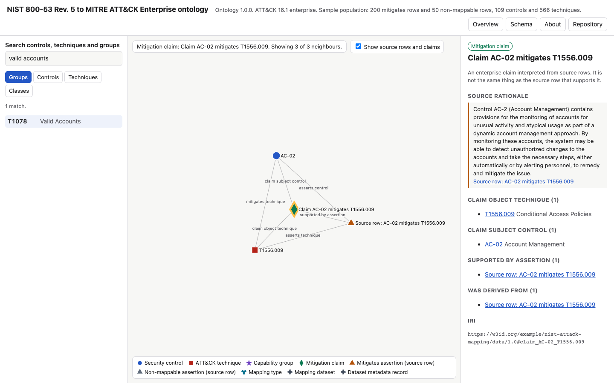

# NIST 800-53 to MITRE ATT&CK enterprise ontology

An enterprise ontology that maps NIST SP 800-53 Rev. 5 security controls to MITRE ATT&CK Enterprise 16.1 techniques, with a navigable graph browser.

**Open the graph: [mmccalla.github.io/nist-attack-enterprise-ontology](https://mmccalla.github.io/nist-attack-enterprise-ontology/)**

The ontology keeps two things apart that mapping tables usually merge: what the source file says (a *source assertion*, one per source row) and what the enterprise chooses to believe (a *mitigation claim*). Each claim must point back to a source row about the same control and technique, and SHACL checks that it does.


## Use the graph browser

Open [`index.html`](index.html) in a browser, either from GitHub Pages or as a local file. It needs no server and makes no network requests.

- **Overview** shows the 109 controls in their 11 capability groups. Circle size is the number of techniques the control mitigates in the sample.
- **Search** or the **Groups**, **Controls** and **Techniques** lists open any node. The graph then shows the node and its neighbours, and the details panel lists every relation as a link.
- **Show source rows and claims** switches the provenance layer on and off. Off, a control links straight to its techniques. On, you see the claim and the source row behind each link.
- **Schema** draws the OWL classes and object properties. Select a class for its restrictions, disjointness and SHACL shape.
- Every view has its own address, such as `#n/control_AC-02` or `#class/:MitigationClaim`, so the back button works and links can be shared.



## Files

| File | Content |
| --- | --- |
| `ontology/nist_attack_enterprise_ontology_v2.ttl` | Authoritative schema: OWL classes, properties, keys and the SKOS vocabularies for capability groups and mapping types |
| `ontology/nist_attack_enterprise_ontology_v2.owl` | RDF/XML outline of the classes and properties (no restrictions) |
| `ontology/nist_attack_enterprise_shapes_v2.ttl` | SHACL shapes, with SPARQL constraints for group consistency and claim support |
| `ontology/nist_attack_enterprise_population_v2.ttl` | Sample population |
| `ontology/ONTOLOGY_V2_README.md` | The bundle's own design notes |
| `index.html` | Standalone graph browser, built from the files above |

The Turtle and OWL files are also served from Pages under [`/ontology/`](https://mmccalla.github.io/nist-attack-enterprise-ontology/ontology/nist_attack_enterprise_ontology_v2.ttl).

## What the sample holds

| Item | Count |
| --- | --- |
| Security controls | 109 |
| ATT&CK techniques and sub-techniques | 566 |
| Capability groups | 11 |
| Mitigates assertions (source rows) | 200 |
| Mitigation claims | 200 |
| Non-mappable assertions (source rows) | 50 |
| Triples, ontology and population | 5782 |

The source dataset has 5410 mapping objects. The sample holds 250 of them, so a missing link in the graph is not a missing link in the source. The sample is also uneven: CM-06 and CA-07 hold 192 of the 200 claims, and only 5 of the 200 source rows carry rationale text.

## Check it

```sh
python -m pip install -r requirements-dev.txt
python -m pytest -q tests                # parse, SHACL, negative probes, manifest, build in sync
python scripts/build_graph.py            # rebuild index.html after a change to ontology/ or src/
npm ci && npx playwright install chromium
npm run uat                              # browser checks on index.html
```

The tests include negative probes. Each one breaks the data in one way (a capability group that differs from the control's group, a claim backed by a row about another control, a malformed technique ID, a non-mappable row with a control, a row without provenance) and asserts that SHACL validation fails.

Verified on 2026-11-01: 11 tests pass with pySHACL 0.40.1 and rdflib 7.6.0, the bundle conforms to its shapes, and the 13 browser checks pass in Chromium.

## Limitations

- The population is a sample, not the full source dataset.
- The namespace is `https://w3id.org/example/nist-attack-mapping/`. The IRIs do not resolve. Replace `example` with a governed namespace before any production use, as the bundle's own notes say.
- A mapping is not evidence that a system has a control in place or that the control stops a technique.
- Technique links open the current ATT&CK site, which can differ from version 16.1.
- The parent technique shown for a sub-technique comes from the ID pattern. The ontology has no sub-technique relation.

## Licence and attribution

Code is MIT ([LICENSE](LICENSE)). The ontology files declare CC BY 4.0. The mappings derive from the MITRE Center for Threat-Informed Defense Mappings Explorer. MITRE ATT&CK® is a registered trademark of The MITRE Corporation. Details are in [ATTRIBUTION.md](ATTRIBUTION.md).
