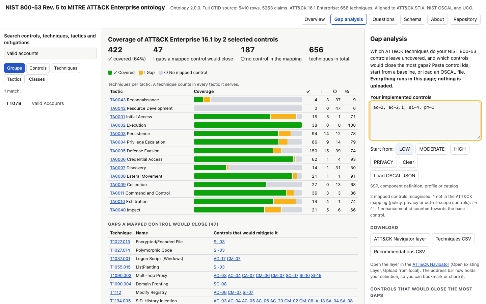

# NIST 800-53 to MITRE ATT&CK: free gap analysis and knowledge graph

This free tool shows which MITRE ATT&CK techniques your NIST SP 800-53 controls can mitigate. It also shows the gaps and the controls that close them.

**Open the tool: [mmccalla.github.io/nist-attack-enterprise-ontology](https://mmccalla.github.io/nist-attack-enterprise-ontology/)**

You do not need an account, an installation or a server. The tool runs in your browser. It does not send your data to a server.

## What you can do

| Task | Where |
| --- | --- |
| Find the ATT&CK techniques that your controls do not cover | [Gap analysis](https://mmccalla.github.io/nist-attack-enterprise-ontology/#gaps) |
| Find the controls that close the most gaps | [Gap analysis](https://mmccalla.github.io/nist-attack-enterprise-ontology/#gaps) |
| Find the ATT&CK techniques that your CIS Safeguards do not cover | [Gap analysis for CIS](https://mmccalla.github.io/nist-attack-enterprise-ontology/#gaps-cis) |
| Find the AI agent techniques that your AI safeguards do not cover | [Gap analysis for AI](https://mmccalla.github.io/nist-attack-enterprise-ontology/#gaps-atlas) |
| Find the controls that mitigate one technique | Search, then open the technique |
| Find the techniques that one control mitigates | Search, then open the control |
| See the source row and the rationale for each claim | Open a claim |
| Get answers to 22 common questions | [Questions](https://mmccalla.github.io/nist-attack-enterprise-ontology/#questions) |
| Use the data in ATT&CK Navigator, a spreadsheet or a script | [Downloads](#downloads) |

## Find your gaps

1. Open [Gap analysis](https://mmccalla.github.io/nist-attack-enterprise-ontology/#gaps).
2. Type or paste the IDs of your implemented controls, for example `AC-2, IA-2(1), SI-4`.
3. If you use a baseline, click LOW, MODERATE, HIGH or PRIVACY instead.
4. If you have an OSCAL file, click **Load OSCAL JSON** instead.
5. Read the coverage per tactic and the list of gaps.
6. Read the list of controls that close the most gaps.
7. To keep the result, bookmark the page or copy the address.

The tool accepts these OSCAL files: a system security plan (SSP), a component definition, a profile or a catalog. The tool counts a control enhancement, for example AC-2(1), as its base control.

The tool shows each technique in one of three states:

| State | Meaning |
| --- | --- |
| Covered | One or more of your controls mitigate the technique. |
| Gap | No selected control mitigates the technique, but a different mapped control can. |
| No mapped control | No NIST 800-53 control in the mapping mitigates the technique. More NIST controls cannot cover it. |

## Use the result in ATT&CK Navigator

1. In Gap analysis, click **ATT&CK Navigator layer**.
2. Open the [ATT&CK Navigator](https://mitre-attack.github.io/attack-navigator/).
3. Click **Open Existing Layer**, then **Upload from local**.
4. Select the file that you downloaded.

Each control page and each baseline page also has a **Navigator layer** button. In the layer, green is covered, amber is a gap and grey is no mapped control. A darker green shows more controls.

## Downloads

All files are free. Each file has a stable address. Thus, a script can get the most recent version.

| File | Content |
| --- | --- |
| [`claims.csv`](exports/claims.csv) | Each control and technique claim, with tactics, baselines and source row numbers |
| [`techniques.csv`](exports/techniques.csv) | Each ATT&CK Enterprise technique, with its controls and mapping status |
| [`controls.csv`](exports/controls.csv) | Each mapped control, with its OSCAL ID and baselines |
| [`navigator/`](exports/navigator) | Navigator layers for each baseline, for all controls and for all CIS Safeguards (ATT&CK 19) |
| [`cis-claims.csv`](exports/cis-claims.csv) | Each CIS Safeguard and ATT&CK 19.1 technique claim, with source row numbers and the CTID rationale |
| [`questions/`](exports/questions) | The answer to each of the 22 questions |
| [`attack-16.1-to-20.0.csv`](exports/attack-16.1-to-20.0.csv) | Each technique that ATT&CK 20.0 changes, with its replacement and its new tactics |
| [`atlas-techniques.csv`](exports/atlas-techniques.csv), [`atlas-mitigations.csv`](exports/atlas-mitigations.csv) | MITRE ATLAS techniques and mitigations |
| [`owasp-llm-atlas-links.csv`](exports/owasp-llm-atlas-links.csv) | The ATLAS techniques that OWASP links to each LLM Top 10 risk (CC BY-SA 4.0) |
| [`ontology/core.ttl`](ontology/core.ttl), [`data/population.ttl`](data/population.ttl) | The full knowledge graph in RDF, for a graph database or SPARQL |

For a file address, add the path to `https://mmccalla.github.io/nist-attack-enterprise-ontology/`. For example: `https://mmccalla.github.io/nist-attack-enterprise-ontology/exports/claims.csv`.

## Coverage for CIS Controls

The tool also includes the CTID mapping of CIS Controls 8.1.2 to ATT&CK Enterprise 19.1: 1,140 claims from 70 Safeguards on 404 techniques. The file marks the other 82 Safeguards as non_mappable.

1. Open [Gap analysis for CIS](https://mmccalla.github.io/nist-attack-enterprise-ontology/#gaps-cis).
2. Type or paste your Safeguard numbers, for example `4.1, 6.3, 10.1`.
3. Read the gaps and the Safeguards that close the most gaps.

Read these limits for CIS coverage:

- The CIS mapping uses ATT&CK 19.1. The NIST mapping uses ATT&CK 16.1. The tool joins the two by STIX id. 29 techniques that CIS maps are only in 19.1, so they cannot have a NIST claim (CQ22).
- The Safeguard titles and Implementation Groups are exact CIS text from CIS Controls 8.1.2, © Center for Internet Security, under CC BY-NC-ND 4.0. Use them for non-commercial purposes only, and do not change them. They are kept apart from the CC BY data (see [`NOTICE.md`](NOTICE.md)).
- Click IG1, IG2 or IG3 to start from an Implementation Group. If you use another CIS version, load your own CIS Controls file (XLSX or CSV). It stays on your device, in memory only.

## Coverage for AI systems and AI agents

ATT&CK and NIST 800-53 do not describe attacks on AI agents. Thus, the tool also includes:

- **MITRE ATLAS 5.6.0:** 170 techniques and 35 mitigations for AI systems. 26 techniques concern AI agents and their tools, for example tool poisoning and agent configuration theft.
- **OWASP GenAI lists:** the LLM Top 10 (2025) with the ATLAS techniques that OWASP links to each risk, and the MCP Top 10 (2025) titles (CC BY-NC-SA 4.0, non-commercial use only). The Agentic Top 10 is a reference.
- **CIS guidance for AI:** each CIS Safeguard page shows CIS's own guidance for AI LLM systems, AI agents and MCP, from the CIS Controls v8.1.2 AI Guidance workbook (CC BY-NC-ND 4.0).
- **[Gap analysis for AI systems](https://mmccalla.github.io/nist-attack-enterprise-ontology/#gaps-atlas):** type your ATLAS mitigations and see which agent techniques stay open.

Read these limits for AI coverage:

- The "AI agent" flag comes from the technique names. ATLAS does not publish it.
- No published mapping exists from ATLAS to NIST 800-53. The tool shows the ATT&CK technique that an ATLAS technique adapts, but NIST claims do not transfer.
- 14 of the 26 agent techniques have no ATLAS mitigation. For these, an agent design needs its own safeguards.
- The Agentic Top 10 item titles are not included. The official document is behind a download form, and the tool does not copy titles from secondary sources.

## Use with AI agents and scripts

The tool has a static JSON API with one small file for each technique, control, CIS Safeguard, tactic, mitigation, baseline and question.

1. Start at [`api/v1/index.json`](https://mmccalla.github.io/nist-attack-enterprise-ontology/api/v1/index.json).
2. Get one file, for example [`api/v1/techniques/T1078.json`](https://mmccalla.github.io/nist-attack-enterprise-ontology/api/v1/techniques/T1078.json).

Each file has a JSON Schema and the fixed limits of the data. The [OpenAPI description](https://mmccalla.github.io/nist-attack-enterprise-ontology/api/v1/openapi.json) and [`llms.txt`](https://mmccalla.github.io/nist-attack-enterprise-ontology/llms.txt) describe the API. The [API guide](docs/api.md) gives the rules for agents.

## Where the data comes from

The tool joins five public sources. The build downloads exact versions of each source. It then compares each file with a known SHA-256 digest.

| Source | Version | Gives |
| --- | --- | --- |
| [MITRE CTID Mappings Explorer](https://ctid.mitre.org/mappings/) | NIST 800-53 Rev. 5 to ATT&CK 16.1, updated 16 April 2025. CIS Controls 8.1.2 to ATT&CK 19.1, updated 25 September 2026 | 5,410 NIST mapping rows and 1,225 CIS mapping rows |
| [MITRE ATT&CK STIX data](https://github.com/mitre-attack/attack-stix-data) | Enterprise 16.1, 19.1 and 20.0 | 656 techniques, 14 tactics, platforms, ATT&CK mitigations and later-version changes |
| [MITRE ATLAS](https://github.com/mitre-atlas/atlas-data) | 5.6.0 | 170 techniques, 35 mitigations and 16 tactics for AI systems |
| [OWASP GenAI Security Project](https://genai.owasp.org/) | Retrieved 2 November 2026 | LLM Top 10 risks and their ATLAS links (CC BY-SA 4.0) |
| [NIST OSCAL content](https://github.com/usnistgov/oscal-content) | SP 800-53 Rev. 5 catalog 5.2.0 | Control titles, families and the SP 800-53B baselines |

The tool keeps each source row separate from the claim that it supports. A claim is a statement that a control mitigates a technique. Each claim shows the source rows behind it.

The build found some possible errors in the NIST source. For example, one row names a Mobile technique (T1521.003). The tool keeps that row but does not make a claim from it. The full list is in [`docs/upstream-findings.md`](docs/upstream-findings.md). It is filed as [CTID issue #151](https://github.com/center-for-threat-informed-defense/mappings-explorer/issues/151).

## Limits

Read these limits before you use a result in a decision.

- A claim shows that a control **can** mitigate a technique. It does not show that your implementation is effective.
- The mapping covers 109 technical base controls in 11 families. It does not include policy controls or control enhancements.
- Some control families are not in the mapping, for example Awareness and Training.
- The mapping uses ATT&CK 16.1. ATT&CK 20.0 revokes, renames or moves 208 of its techniques. Each technique page shows the change, and [`attack-16.1-to-20.0.csv`](exports/attack-16.1-to-20.0.csv) lists them.
- 91 ATT&CK Enterprise techniques do not have a row in the mapping. The tool shows these techniques as "no mapped control". That result does not mean that no defence exists.
- The control titles come from the OSCAL catalog 5.2.0. The mapping uses an older Rev. 5 release. Three titles are different.
- The IRIs in the knowledge graph use the `w3id.org/example` namespace. These IRIs do not resolve.

## Security and privacy

- The page cannot send data anywhere. Its Content Security Policy blocks all network requests.
- The page runs only its own scripts. It shows all source data as text.
- Each change to `main` goes through a pull request. GitHub runs the tests, the browser checks, the dependency audits and CodeQL on it, and requires signed commits.
- To report a vulnerability privately, read [`SECURITY.md`](SECURITY.md).
- The threat model and the controls are in [`docs/security.md`](docs/security.md).

## Get help or report a problem

- To report an incorrect claim or a claim that is not there, use the [mapping issue form](https://github.com/mmccalla/nist-attack-enterprise-ontology/issues/new/choose).
- To ask for a new question, use the competency question form on the same page.
- For other problems, open a [blank issue](https://github.com/mmccalla/nist-attack-enterprise-ontology/issues/new).

If the source row is incorrect, the project records the finding in [`docs/upstream-findings.md`](docs/upstream-findings.md) and reports it to MITRE CTID. The findings of 2026-11-02 are [CTID issue #151](https://github.com/center-for-threat-informed-defense/mappings-explorer/issues/151).

## Cite this tool

Use the data in [`CITATION.cff`](CITATION.cff). GitHub shows a **Cite this repository** link for this file. Each release is on the [Releases page](https://github.com/mmccalla/nist-attack-enterprise-ontology/releases), and the changes are in [`CHANGELOG.md`](CHANGELOG.md).

## For maintainers and contributors

These documents give the design and the tests:

| Document | Content |
| --- | --- |
| [`CONTRIBUTING.md`](CONTRIBUTING.md) | How to build the tool and run the tests |
| [`docs/competency-questions.md`](docs/competency-questions.md) | The 22 questions, their personas and their answers |
| [`docs/semantic-decisions.md`](docs/semantic-decisions.md) | Scope, source terms, ambiguities and design decisions |
| [`docs/vocabulary-alignment.md`](docs/vocabulary-alignment.md) | The alignment to ATT&CK STIX, NIST OSCAL and UCO |
| [`docs/evaluation.md`](docs/evaluation.md) | The test gates and their most recent results |
| [`docs/security.md`](docs/security.md) | Threat model, controls and evidence |
| [`docs/roadmap.md`](docs/roadmap.md) | Planned work |
| [`docs/api.md`](docs/api.md) | The agent API: endpoints, fields and rules |

The original ontology bundle is in [`ontology/v2/`](ontology/v2). It has no changes.

## Licence and attribution

- The code has the MIT licence ([`LICENSE`](LICENSE)).
- The ontology and the project's own data have the CC BY 4.0 licence.
- Third-party content keeps its own licence. These licences do not apply to it.
- [`NOTICE.md`](NOTICE.md) gives the copyright notice, the licence and the changes for each source. The full licence texts are in [`LICENSES/`](LICENSES).
- If you copy the data, keep the notices with it. For example, the ATT&CK terms of use require MITRE's copyright notice and the licence in each copy.
- MITRE ATT&CK® is a registered trademark of The MITRE Corporation. CIS Controls® is a registered trademark of the Center for Internet Security. No publisher sponsors or endorses this tool.
- The CIS Controls 8.1.2 titles and Implementation Groups are exact CIS text under CC BY-NC-ND 4.0 (non-commercial use only), in separate, labelled places. The tool copies no CSA Cloud Controls Matrix content.

The full attribution is in [`ATTRIBUTION.md`](ATTRIBUTION.md).
