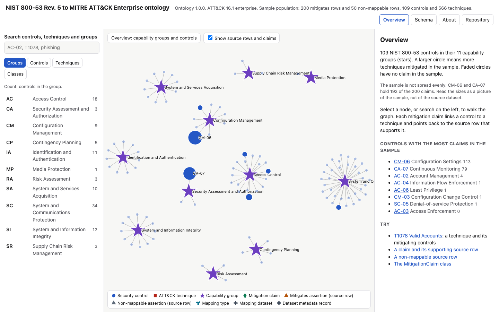
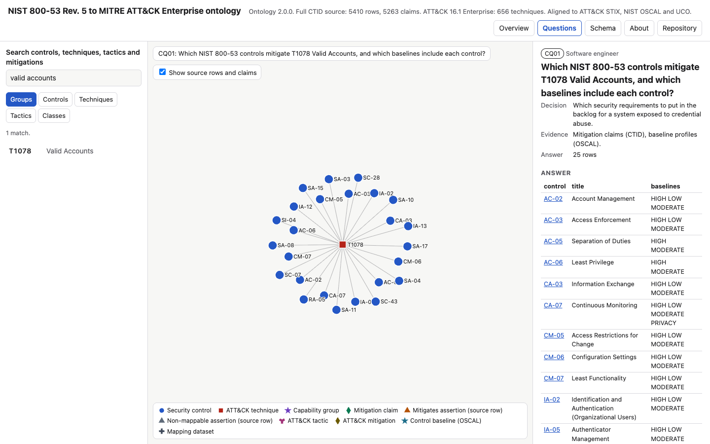

# NIST 800-53 to MITRE ATT&CK enterprise ontology

An enterprise ontology that maps NIST SP 800-53 Rev. 5 security controls to MITRE ATT&CK Enterprise 16.1 techniques. It is aligned to ATT&CK STIX, NIST OSCAL and the Unified Cyber Ontology (UCO), and comes with a navigable graph browser and 13 competency questions answered from the graph.

**Open the graph: [mmccalla.github.io/nist-attack-enterprise-ontology](https://mmccalla.github.io/nist-attack-enterprise-ontology/)**

The ontology keeps two things apart that mapping tables usually merge: what the source file says (a *source assertion*, one per source row) and what the enterprise chooses to believe (a *mitigation claim*). A governed rule decides which rows become claims, and every claim points back to the rows that support it.



## Use it in your work

- **Find your gaps.** Open [Gap analysis](https://mmccalla.github.io/nist-attack-enterprise-ontology/#gaps), paste the NIST 800-53 controls you have implemented (or start from a baseline, or load your OSCAL SSP), and see which ATT&CK techniques are covered, which a mapped control would close and which controls would close the most. It runs entirely in your browser; nothing is uploaded. The address bar keeps your selection, so you can bookmark or share it.
- **Take it into ATT&CK Navigator.** Download a Navigator layer from the gap analysis or from any control or baseline page, or use the static layers in [`exports/navigator/`](exports/navigator).
- **Take it into a spreadsheet or script.** [`exports/claims.csv`](exports/claims.csv), [`techniques.csv`](exports/techniques.csv), [`controls.csv`](exports/controls.csv) and every competency answer in [`exports/questions/`](exports/questions) have stable URLs, for example `https://mmccalla.github.io/nist-attack-enterprise-ontology/exports/claims.csv`.
- **Query it.** Load `ontology/core.ttl` and `data/population.ttl` into any RDF store and run the SPARQL in [`queries/`](queries).


## What changed in 2.0.0

Version 2.0.0 revises the uploaded v2 bundle (kept unchanged in [`ontology/v2/`](ontology/v2)) by following the method in *A Practical Guide to Ontology Engineering*: competency questions first, then discovery, reuse, formalisation, validation, population and evaluation.

- **Competency questions.** 13 questions from six personas, each a SPARQL file with its decision, evidence and an acceptance test. See [docs/competency-questions.md](docs/competency-questions.md).
- **Alignment to external cyber ontologies.** Separate modules for [UCO 1.5.0](ontology/alignment-uco.ttl) (OWL axioms, validated against UCO's own SHACL shapes), [ATT&CK STIX 2.1](ontology/alignment-stix.ttl) and [NIST OSCAL](ontology/alignment-oscal.ttl) (annotations plus STIX and OSCAL identifiers on every entity, because neither has a normative RDF form). Each decision and each rejected candidate is in the [alignment register](docs/vocabulary-alignment.md).
- **Authoritative identity.** Techniques carry their STIX id, tactics, platforms, parent technique and ATT&CK mitigations from the pinned ATT&CK STIX bundle. Controls carry their OSCAL id, OSCAL title and SP 800-53B baselines, matched through the OSCAL catalog's own zero-padded label.
- **Full population.** All 5410 source rows instead of the 250-row sample, built reproducibly from pinned files with SHA-256 checks.
- **Corrections found by discovery.** Non-mappable is a status, not a mapping type. `capability_description` holds titles. 50 rows are exact duplicates. One row (SC-12 to T1521.003) names a technique outside ATT&CK Enterprise; rule R1 keeps the row and withholds the claim. See [docs/semantic-decisions.md](docs/semantic-decisions.md).
- **Separate gates.** Logical consistency (HermiT), data conformance (SHACL), alignment conformance (UCO shapes) and competency coverage (answers recomputed from the raw sources), each with negative probes. See [docs/evaluation.md](docs/evaluation.md).

## Use the graph browser

Open [`index.html`](index.html) in a browser, from GitHub Pages or as a local file. It needs no server and makes no network requests.

- **Overview** shows the 109 controls in their 11 families. Circle size is the number of techniques the control mitigates.
- **Questions** lists the competency questions. Each shows its persona, decision, evidence, SPARQL and answer; answer cells link into the graph.
- **Search** and the **Groups**, **Controls**, **Techniques** and **Tactics** lists open any node. The Techniques list filters by status: with claims, non-mappable, not in the mapping, or outside ATT&CK Enterprise.
- **Show source rows and claims** switches the provenance layer on and off.
- **Schema** draws the classes with their UCO superclasses. Select a class for its restrictions, alignments and SHACL shape.
- **About** lists the pinned sources with digests and what the cross-checks found.
- Every view has its own address, such as `#n/control_AC-02`, `#q/CQ05` or `#class/:MitigationClaim`.



## Files

| Path | Content |
| --- | --- |
| `ontology/core.ttl` | TBox, RBox and controlled vocabularies, version 2.0.0 |
| `ontology/shapes.ttl` | SHACL shapes for data conformance |
| `ontology/alignment-uco.ttl`, `alignment-stix.ttl`, `alignment-oscal.ttl` | Alignment modules |
| `ontology/v2/` | The original uploaded bundle (version 1.0.0), unchanged |
| `data/population.ttl` | ABox generated from the pinned sources (do not edit) |
| `data/source-checks.json` | Source digests, counts and cross-check findings |
| `queries/cq*.rq` | Competency questions in SPARQL |
| `scripts/build_population.py` | Builds the population from the pinned sources |
| `scripts/build_graph.py` | Builds `index.html` from the ontology, population and queries |
| `docs/` | Scope, semantic inventory, decisions, alignment register, competency questions, evaluation |
| `exports/` | CSV tables and ATT&CK Navigator layers, generated by `scripts/build_exports.py` |

The Turtle files are also served from Pages, for example [`ontology/core.ttl`](https://mmccalla.github.io/nist-attack-enterprise-ontology/ontology/core.ttl).

## Check it

```sh
python -m pip install -r requirements-dev.txt   # rdflib, pySHACL, owlready2 (HermiT needs Java 11 or later)
python scripts/build_population.py --check      # downloads the pinned sources once, checks digests and the population
python -m pytest -q tests                       # all gates
python scripts/build_graph.py && python scripts/build_exports.py   # rebuild the browser and exports after a change
npm ci && npx playwright install chromium && npm run uat   # browser checks
```

## Limitations

- The namespace is `https://w3id.org/example/nist-attack-mapping/`. The IRIs do not resolve. Replace `example` with a governed namespace before production use.
- A mapping is not evidence that a system has a control in place or that the control stops a technique.
- Answers that rest on absence (CQ03, CQ04, CQ11, CQ12) are closed-world readings of the pinned sources, not proof that nothing else exists.
- OSCAL titles come from catalog 5.2.0; the mapping was built against an earlier Rev. 5 release.
- Full-population OWL reasoning uses a profile without number and `hasValue` restrictions (decision D13); those are reasoned on a slice and enforced by SHACL on the whole population.

## Contribute and cite

Report a wrong or missing mapping, or propose a competency question, through the [issue templates](https://github.com/mmccalla/nist-attack-enterprise-ontology/issues/new/choose); see [CONTRIBUTING.md](CONTRIBUTING.md). Cite with [CITATION.cff](CITATION.cff). Changes are in [CHANGELOG.md](CHANGELOG.md).

## Licence and attribution

Code is MIT ([LICENSE](LICENSE)). The ontology files declare CC BY 4.0. Mappings derive from the MITRE Center for Threat-Informed Defense Mappings Explorer; technique data from the ATT&CK STIX bundle; control and baseline data from NIST OSCAL content; UCO core is Apache 2.0. MITRE ATT&CK® is a registered trademark of The MITRE Corporation. Details are in [ATTRIBUTION.md](ATTRIBUTION.md).
